[Email me](mailto:m.bayu1405@gmail.com) · [LinkedIn](https://www.linkedin.com/in/rafael-mahesa-bayu-raditya-683356371/) · [Instagram](https://www.instagram.com/rafaellmahesaa/) · [Portfolio site](https://rafaelsfix10smbr.github.io/portfolio-prototype/Rafael%20Mahesa%20Bayu%20Raditya.html)
 
<h2></h2>
 

I'm an Information Systems undergraduate at Brawijaya University, and machine learning is where my curiosity is heading. I enjoy the whole path from messy data to a working model: exploratory data analysis, cleaning, preprocessing, modeling and computer vision, which is how a machine learns to see.
 
Alongside that, I build for the web and for mobile. HTML, CSS, PHP, SQL integration and Laravel cover the front end and the data behind it, and Flutter lets me put together basic Android apps.
 
Underneath it all is a creative base: over four years of graphic design, plus photography and video editing. I've designed, photographed and edited for several university committees and organizations, and most recently led the media and information team for an event committee.
 
Based in Malang, East Java, Indonesia.
 
 

<h2></h2>
 
From data to design. I work with data through cleaning, exploration, preprocessing and modeling, build web pages with HTML, CSS, PHP, SQL and Laravel, and put together basic Android apps in Flutter. On the creative side I make visual identities from scratch: guidebook covers, ID cards, lanyards and reveal feeds in Figma and Canva, plus event photography and teaser videos edited in Premiere Pro and CapCut. What ties it together is consistency: colors, typography and tone unified across every piece, so the result feels like one brand.
 
<h2></h2>
 
| | |
|---|---|
| **Machine Learning Fundamentals** | Exploratory data analysis, data cleaning, preprocessing, modeling and computer vision. The area I most want to grow into. |
| **Front-End Programming** | HTML, CSS, PHP, SQL integration and the Laravel framework, for pages that connect to real data. |
| **Basic Android App Development** | Flutter, for building simple Android apps from a single codebase. |
| **Graphic Design** | Figma, Canva, Adobe Premiere Pro, CapCut and other external design tools. Feeds, ID cards, guidebooks, lanyards and teaser videos. |
| **Photography and Editing** | Event photography and photo and video editing for media campaigns: committee portraits, reveal feeds, documentation and teasers. |
 
<h2></h2>
 
 **Coordinator of Media and Information**, Jambore Rohani UAKKAT
April to November 2026
- Led and supervised a team responsible for the event's media and information output
- Photographed content for Committee Reveal feeds and staff ID cards
- Designed graphics for the Committee Reveal social media feeds
- Edited and produced the event's teaser video
**Staff, Design and Multimedia**, Paskah UB
April to May 2026
- Photographed content for Committee Reveal feeds and staff ID cards
- Designed graphics for the Committee Reveal social media feeds
- Documented event activities through photography
**Staff, Design and Multimedia**, Women Empowerment Cup, FILKOM
March to May 2026
- Designed the event guidebook's cover and background, plus staff ID cards and lanyards
- Edited and produced the event's teaser video
<h2></h2>
 
A mix of the creative work I've made for Jambore Rohani, Paskah UB and WE CUP FILKOM: reveal feeds, ID cards, a guidebook cover, lanyards, teaser videos and event photography. My web and data work is in the portfolios below.
 

<h2></h2>
 
- **Brawijaya University**, Undergraduate of Information Systems, 2025 to present. A growing focus on data science, analytics and machine learning.
- **Saint Joseph College Catholic Senior High School**, 2022 to 2025
<h2></h2>
 
- **Business & Growth Department, Marketing Communications Division**, ShARE Brawijaya University, November 2026 to present
- **Core Team, Media Creative Division**, Google Developer Groups on Campus Brawijaya University, August 2026 to present
- **Media and Information Division**, Unit Aktivitas Kerohanian Katolik (UAKKat), March to December 2026
- **Media, Information & Communications Department**, OPTIIK FILKOM, February to December 2026
<h2></h2>
 
<!-- Replace YOUR-DATA-SCIENCE-REPO with the repo name, then pin that repo on your profile. -->
**[Data Analytics](https://github.com/RAFAELSFIX10SMBR/YOUR-DATA-SCIENCE-REPO)**
Data cleaning, exploration and machine learning work.
 
**Web Development**, coming soon
Front-end and Laravel work, and basic Flutter apps.
 
**Graphic Design**, coming soon
Feeds, identities, photography and teaser videos.
 
<h2></h2>
 
[m.bayu1405@gmail.com](mailto:m.bayu1405@gmail.com) · [LinkedIn](https://www.linkedin.com/in/rafael-mahesa-bayu-raditya-683356371/) · [GitHub](https://github.com/RAFAELSFIX10SMBR) · [@rafaellmahesaa](https://www.instagram.com/rafaellmahesaa/)
 
